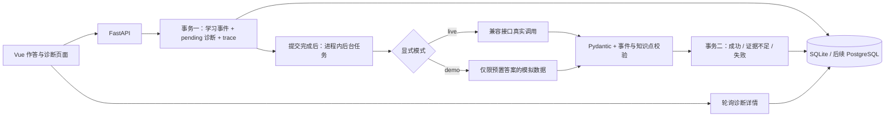
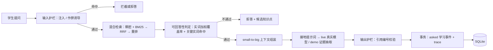

# 系统架构（Sprint 0 + M7 检索增强）

## 诊断链路（M8）

事件 actor 固定为 sim-student-001；event_id、diagnosis_id 和 trace_id 由服务端生成 UUID。
JSON 的 object/result/context 保留统一格式。模型接收题目、答案和可用证据事件 ID，不接收学生身份。
诊断与事件一对一（通过提交接口保证）；重试在同一诊断下创建新 trace，不重复创建作答。
result.correct=null：简答题尚未实现确定性判分，不能把模型诊断等同正式成绩。

可靠性：先提交数据库事务再调度模型；HTTP 202 返回保存确认，页面查询结果。
失败返回明确代码而不是伪造结果。重试通过数据库条件更新防止同时领取同一失败诊断。
后台执行期间不保持数据库写事务。启动时将 pending 标为 PROCESS_INTERRUPTED，仅适用单进程部署。

## 助教链路（M7）

提问者身份由服务端固定，不接受客户端传入。模型调用期间不持有数据库写事务。
`mode=live` 走真实大模型；缺少密钥时返回 `MISSING_API_KEY` 并**仍然保存学生的问题**，
只写入失败 trace，不写入任何伪造回答。`mode=demo` 的回答由检索证据抽取拼接，输出带显式标注，
事件标记 `synthetic=true`。

检索链路的每一步（稠密排名、稀疏排名、RRF、覆盖率、可回答性特征、引用校验结果）
都写入 `model_traces.details`，可按 trace ID 回放。

## 数据与边界

`data/kb/` 存放课程讲义与知识点元数据；`data/index/` 是构建产物（可重建，不入版本控制）；
`data/eval/` 是评测集与报告。索引在首次请求时若缺失会自动构建（<1 秒），也可用
`scripts/build_rag_index.py` 预构建。

校验保证的是 JSON 结构、数值范围、当前事件归属和知识点一致性；不能自动证明语义正确。
知识库当前覆盖 5 个知识域、39 个知识点，**尚无软件测试章节**；提问测试相关内容会被正确拒答。
登录鉴权、独立任务队列、学生画像与推荐、正式评测报告尚未实现。

实现参考：[FastAPI 后台任务](https://fastapi.tiangolo.com/tutorial/background-tasks/)、
[SQLAlchemy SQLite 方言](https://docs.sqlalchemy.org/en/20/dialects/sqlite.html)。
