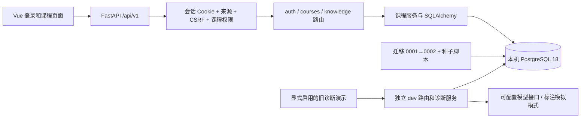

# P1 账号与课程基础架构

> 后续页面框架已补充：四类页面通过 api/workspace.ts 调用受保护的 workspace 路由；业务占位统一返回 501，显式前端预览与数据库隔离。当前交接状态见 [接口交接](handoff-api.md) 和 [待办](handoff-todo.md)。下文 P1 验证为历史记录。

更新：2026-10-14。已实现账号、角色、课程、章节、知识点和成员管理；资源、RAG、正式测验和画像仍按 [主规划](../需求规划.md) 待开发。

## 部署与身份

前端构建产物由 FastAPI 提供，保持同源；Vite 开发时代理 /api 和 /health。单进程后台任务仍只服务旧课堂演示。服务运行于 127.0.0.1:8000；本机原生 PostgreSQL 18，不依赖 Docker。向量扩展尚不可用，P1 不使用向量字段。

会话随机 token 以 HttpOnly SameSite=Lax Cookie 发送，数据库仅保存 SHA-256 token 哈希；密码采用 Argon2id。会话保存过期时间和 CSRF token，退出删除会话，登录轮换当前浏览器旧会话。API 写入校验显式受信任 Origin 与 X-CSRF-Token，登录也校验 Origin。生产 HTTPS 时 COOKIE_SECURE=true。

教师编辑必须同时满足全局教师角色与本课程教师成员身份。学生只能列出已加入课程，不能查看成员或修改课程。课程内容对该课程所有成员共享，所以学生能看到教师更新，但不能查询另一个课程；个人作答数据权限属于后续模块，不在本轮虚构实现。

## 数据与迁移

新增 users、sessions、courses、course_members、chapters、knowledge_points。课程知识点 code 唯一，成员 course/user 唯一；章节和知识点关联实际课程。0001 旧表保持，0002 增量建表。种子用稳定 UUID，重复执行不重置密码或覆盖编辑，遇到已有同名非种子账号拒绝覆盖。

数据库为独立 se_learning，应用连接使用非超级用户 se_learning_app。数据库及演示初始密码只在本机 .env；原 SQLite 文件保留，未自动搬迁。测试使用随机 PostgreSQL schema，测试后清理，不删除应用表。

## 旧演示边界

旧 main.py 路由移到 api/routes/dev.py，旧模型移到 models/legacy.py 并从 models/__init__.py 兼容导出。/api/dev/* 和旧 /api/diagnoses* 只有 ENABLE_DEV_ROUTES=true 才注册，默认关闭；本机为保留演示显式启用。这些记录仍固定模拟学生，无登录归属，不能当成正式学生记录。

先保存事件/pending 诊断/trace，再调用模型；失败不回滚作答，重试新建 trace。启动恢复将中断任务标失败，只适用单 worker。固定知识点和空引用限制仍存在，P5 扩展。

## 验证

48 项后端测试通过，包括 SQLite/PostgreSQL 权限和增量迁移；Alembic check 无 schema 漂移。前端构建和教师/学生浏览器流程通过。详见 [P1 记录](sprint/p1-foundation.md)。目标目录见 [实施路线](implementation-plan.md)，运行接口见 [api.yaml](api.yaml)。
