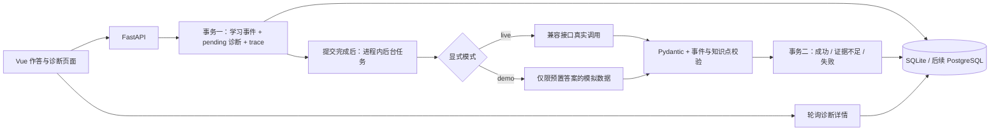

# Sprint 0 架构

事件 actor 固定为 sim-student-001；event_id、diagnosis_id 和 trace_id 由服务端生成 UUID。
JSON 的 object/result/context 保留统一格式。模型接收题目、答案和可用证据事件 ID，不接收学生身份。
诊断与事件一对一（通过提交接口保证）；重试在同一诊断下创建新 trace，不重复创建作答。
result.correct=null：简答题尚未实现确定性判分，不能把模型诊断等同正式成绩。

可靠性：先提交数据库事务再调度模型；HTTP 202 返回保存确认，页面查询结果。
失败返回明确代码而不是伪造结果。重试通过数据库条件更新防止同时领取同一失败诊断。
后台执行期间不保持数据库写事务。启动时将 pending 标为 PROCESS_INTERRUPTED，仅适用单进程部署。

校验保证的是 JSON 结构、数值范围、当前事件归属和知识点一致性；不能自动证明语义正确。
无课程资料，citations 强制为空。尚无检索、登录鉴权、独立任务队列和正式评测。

实现参考：[FastAPI 后台任务](https://fastapi.tiangolo.com/tutorial/background-tasks/)、
[SQLAlchemy SQLite 方言](https://docs.sqlalchemy.org/en/20/dialects/sqlite.html)。
