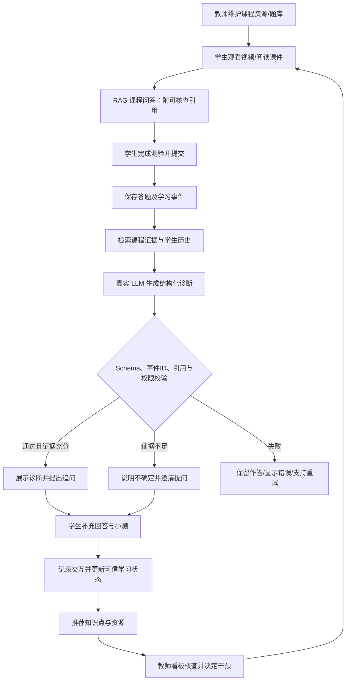

# 软件工程课程智能学习辅助系统｜需求规划与 Codex 开发路线（v1.0）

> **文档性质**：开发前需求规划草案，可直接放入本地仓库的 `docs/requirements-plan.md`，供组员审查、Codex 分阶段执行。尚未完成的功能与评测均属于**计划**，不代表已实现。  
> **项目定位**：老师选题一「面向学生的学习系统」；在原「软件工程智能学习平台」基础上突出 RAG 问答、错题诊断与引导式追问。  
> **需求依据**：《项目需求规格说明》《实践项目要求》《验收标准》，以及第三次课《可验证需求任务单》。原文档中的 M1–M10 必做主线与 E1–E7 选做模块要求仍按教师要求执行；本文件中的 FR 编号是**本组自定义功能编号**，不能代替官方 M/E 编号。

## 1. 项目目标与核心研究问题

### 1.1 项目名称（建议）

**基于 RAG 与大语言模型的软件工程课程智能学习辅助系统**

### 1.2 目标用户

- **学生**：浏览课程资源、向 AI 助教提问、完成测验、理解错题、获得学习建议。
- **教师**：管理课程资源与题库，核查诊断证据，查看学生和班级学情，必要时人工干预。

### 1.3 核心问题

相比「直接展示标准答案与解析」，**结合课程资料引用、学生答题和对话数据的 AI 错误诊断与引导式追问**，能否更准确地发现概念混淆，并帮助学生在后续练习中纠正理解？

### 1.4 五个重点业务功能

| 本组编号 | 业务功能 | 首版最小能力 | 对应原需求 |
|---|---|---|---|
| FR-01 | 课程知识库管理 | 上传、解析课程材料，关联章节/知识点，支持基于原文的检索 | M3、M4 |
| FR-02 | RAG 课程智能问答 | 检索→生成→引用可跳转的课件页/视频时间点；无依据拒答 | M7 |
| FR-03 | 智能测验与错题管理 | 教师出题、学生提交、客观题判分、错题及事件记录 | M5、M6 |
| FR-04 | AI 错误诊断与引导式追问（重点做深） | 错误原因、有根据的诊断、一次追问与再次作答记录 | M8；与 E1 关联 |
| FR-05 | 学生画像与学习路径推荐 | 按知识掌握度与先修依赖推荐学习顺序与资源 | M9；与 E7 关联 |

> **范围说明**：以上五项是研究方向的重点功能，不代表可以省略原平台 M1 登录课程、M2 视频学习或 M10 教师看板等必做内容。建议选做模块候选为 **E1（5E 学习智能体）与 E7（推荐算法与路径规划增强）**，最后按教师协调结果确定。仅实现一次追问不等于已完成 E1 全部五阶段要求。

## 2. 一条可端到端演示的用户流程（主线）

### 2.1 典型情境

- 教师预先发布「软件验证与确认」知识点及配套课件、练习题。
- 学生误把「软件验证」解释为「检查软件是否满足用户实际需求」，体现「验证与确认」概念混淆。
- 系统需用真实作答事件及已入库课程资料支持诊断，生成不直接泄露当前测验答案的引导式问题，并在下一轮作答后更新学习状态。

### 2.2 连续业务步骤

| 步骤 | 行动方 | 操作与系统行为 | 应产生的证据/数据 |
|---|---|---|---|
| S0 | 教师 | 上传课程资料、关联知识点，维护测验题库和先修关系 | 资源、知识点、题目及关联关系 |
| S1 | 学生 | 登录课程，观看视频或预览课件 | `learning_events` 中的浏览/播放记录 |
| S2 | 学生+AI 助教 | 提出课程问题；系统检索课程片段、返回有出处的回答 | 问答记录、检索引用、模型调用 trace |
| S3 | 学生 | 完成知识点测验并提交 | 答案、正误、用时、对应知识点、提交事件 |
| S4 | 诊断智能体 | 自动读取授权的答题/行为/对话事件，检索课程资料，生成结构化诊断 | JSON 诊断、掌握度/置信度、错误类型、证据事件 ID、资料出处 |
| S5 | 学生+引导智能体 | 展示有证据的诊断；提出一条引导性追问；学生回答 | 追问题目、追问回答、会话事件 |
| S6 | 系统 | 对追问和补充练习进行分析；仅在证据有效时更新知识状态 | 诊断历史、画像/掌握度变化记录 |
| S7 | 推荐模块 | 根据先修关系、掌握度和资源关联推荐下一步知识点与学习资料 | 有序推荐路径、具体资源、理由 |
| S8 | 教师 | 查看学生时间线、诊断证据和推荐，决定是否干预 | 学情看板、人工处理记录（如有） |

### 2.3 主线状态与分支

- `quiz_in_progress`：测验进行中，助教不得给当前试题的直接答案；可以给一般性学习提示。
- `quiz_submitted`：答案已保存；即使大模型不可用也不回滚测验提交。
- `diagnosis_pending`：异步生成诊断，前端可查询处理状态。
- `diagnosis_supported`：输出通过 JSON Schema、证据存在性、授权范围与引用检查，可以展示。
- `diagnosis_insufficient`：答案过短或证据不充分，明确说明暂不能判断原因，先询问学生的思路。
- `diagnosis_failed`：模型不可用、格式错误或引用虚假；保留答题记录、日志可追踪、允许重试；不更新画像。
- `followup_answered`：追问回复已经保存，允许触发复测或复核，不直接等同“已完全掌握”。



## 3. 技术选型（建议统一 Python 后端）

### 3.1 技术栈

| 层 | 建议 | 选用原因 |
|---|---|---|
| 前端 | Vue 3 + TypeScript + Vite + Element Plus | 快速开发学生/教师界面，便于组件化测试 |
| 后端 | Python 3.11+ / FastAPI / Pydantic / SQLAlchemy / Alembic | API 开发快、自动 OpenAPI 文档、严格 JSON Schema、便于整合 AI 与评测脚本 |
| 数据库 | PostgreSQL + pgvector（Docker Compose 启动） | 统一保存业务数据与向量；减少单独部署向量服务的复杂度 |
| 课程资料解析 | pypdf / python-pptx / python-docx（按文件类型） | 提取 PDF、PPTX、DOCX 文本与页码；扫描文档另行处理 |
| RAG | 可配置 embedding API + pgvector 余弦检索；后续按评测考虑重排 | 优先实现透明、可测试的检索流程 |
| LLM | 配置化的兼容 OpenAI 风格 API 客户端 | 必须真实调用模型；模型名、API 地址、提示版本可配置 |
| 测试与质量 | pytest、httpx、前端基础测试、GitHub Actions | 单元、接口、契约、回归、密钥扫描 |
| 部署 | Docker Compose | 一键启动、可复现部署 |

**为什么不优先 Spring Boot？** Spring Boot 适合业务系统，完全能实现要求；但这个项目的核心研发在 RAG、错误诊断、知识追踪和评测。Python 将 AI 服务、后端与评测放在同一生态，通常更易于实验和迭代。如果全组 Java 明显更熟，可改 Spring Boot + Spring AI/LangChain4j，但不要初版同时维护 Java 与 Python 两个后端。

### 3.2 AI 组件组织方式

初版采用**单体后端 + 清晰的服务层**，不做微服务拆分，也不强制一开始引入复杂 Agent 框架。

```text
Vue 页面
    ↓ REST API
FastAPI 路由/鉴权
    ├─ 课程与资源服务
    ├─ 测验与学习事件服务
    ├─ RAG 检索服务
    ├─ 诊断与追问服务（LLM + Schema/证据校验）
    ├─ 掌握度/推荐服务
    └─ 教师学情服务
    ↓
PostgreSQL + pgvector（数据、日志、向量、学习状态）
    + 配置化大模型/Embedding API
```

### 3.3 关键工程约束

- API Key 只出现在后端环境变量和 `.env`（不提交 Git），前端不保存密钥。
- 课程检索的引用保存**原始资源 ID、页码/视频时间点、片段 ID**，不能让大模型临时编造页码。
- 诊断证据事件编号必须由后端数据库核验归属和真实性，不能只相信模型的字符串。
- 学生只能访问自己的记录；教师访问本课程授权的学生数据；越权接口返回 403。
- **先提交答题事务，再启动诊断**：避免 LLM 网络失败造成学生提交失败。MVP 可用 FastAPI 后台任务配合数据库状态字段；生产化再考虑队列。
- 模型调用记录 trace_id、模型、提示版本、输入摘要、检索证据、延迟、token、估计费用和错误状态；敏感信息脱敏。
- 前期不用模型微调、不上微服务/Kubernetes、不做复杂多智能体调度。

## 4. 数据模型：先最小，后覆盖全部主线

### 4.1 MVP 必需实体（建议）

| 表 / 实体 | 核心字段（示例） | 用途 |
|---|---|---|
| `users` | id, role, password_hash | 学生/教师及权限 |
| `courses` / `chapters` / `knowledge_points` | id, title/name, course_id, chapter_id | 课程层级、知识点 |
| `knowledge_edges` | source_kp_id, target_kp_id, relation_type | 先修依赖；新增边必须校验无环 |
| `resources` / `resource_chunks` | id, kp_id, filename, source_page, text, embedding | 可追溯课程资料与向量检索 |
| `questions` / `quiz_attempts` / `attempt_answers` | question_id, kp_id, attempt_id, answer, correct, duration_ms | 客观题、提交、判分、错题记录 |
| `learning_events` | event_id, actor, verb, object, result, context, timestamp | 全平台一致的事件数据 |
| `chat_sessions` / `chat_messages` | session_id, student_id, kp_id, text, citations | RAG 多轮问答 |
| `diagnoses` / `followup_turns` | diagnosis_id, status, diagnosis_json, evidence_ids, followup, answer | 错误诊断、追问与历史 |
| `mastery_profiles` / `recommendations` | student_id, kp_id, mastery, confidence, reason, resource_ids | 画像和路径 |
| `model_traces` | trace_id, model, prompt_version, tokens, latency, cost | AI 可观测性 |

**学习事件格式沿用原规格 5.2**：`event_id`、`actor`、`verb`、`object`、`result`、`context`、`timestamp`。任何新事件都应复用统一格式，避免各模块另造一套日志结构。

### 4.2 结构化诊断返回契约（字段草案）

```json
{
  "status": "supported",
  "knowledge_point_id": "KP-VAL-01",
  "mastery": 0.45,
  "confidence": 0.72,
  "problem_type": "concept_confusion",
  "problem_description": "可能混淆了验证与确认的关注点",
  "evidence_event_ids": ["EVT-101"],
  "citations": [{"resource_id": "RESOURCE-ID", "chunk_id": "CHUNK-ID", "page_no": null}],
  "recommendation": "先回顾两个概念的定义并比较应用场景",
  "followup_question": "若软件符合设计规格却未满足用户实际需要，你会如何分析？"
}
```

> **注意**：上述数值、ID 和文本仅是**契约示例，不是模型真实输出或评测数据**。`page_no` 需要在实际导入资料后确定，不能从该示例推定出处。后端必须校验知识点 ID、事件 ID、资料 ID 及其访问权限；证据不足时使用 `insufficient` 状态，不输出貌似确定的诊断。

## 5. 第一版计划实现的 API

| 方法 | 路径（建议，非原规格强制） | 说明 |
|---|---|---|
| POST | `/api/auth/login` | 学生/教师登录 |
| GET | `/api/courses/{id}/outline` | 获取章节与知识点 |
| POST | `/api/resources` | 教师上传课程资料并解析入库 |
| POST | `/api/chat/ask` | RAG 问答，响应含可验证 citations |
| POST | `/api/quizzes/{id}/submit` | 提交测验、判分、入库学习事件并触发诊断任务 |
| GET | `/api/diagnoses/{id}` | 查询诊断状态及结构化结果 |
| POST | `/api/diagnoses/{id}/followups` | 学生回答追问、记录事件并反馈 |
| GET | `/api/students/me/mastery` | 学生画像、知识点掌握度 |
| GET | `/api/students/me/recommendations` | 个性化学习路径及引用理由 |
| GET | `/api/teacher/students/{id}/timeline` | 教师端授权的学情与诊断时间线 |

所有接口需要在 `docs/api.yaml` 中逐步维护契约；不要因为此表存在就把接口视为已经开发完成。测验进行中的防泄题检查应放在后端，而不只通过前端隐藏按钮。

## 6. 可执行验收场景（先编测试，再逐步实现）

| ID | 场景 | 给定输入/异常 | 核心通过判据 |
|---|---|---|---|
| AC-FR04-01 | 正常概念混淆 | 预标注「验证与确认」混淆的模拟作答及对话 | 能识别混淆；诊断 Schema 合法；事件证据真实、课程出处有效；生成相关追问并记录回复 |
| AC-FR04-02 | 信息不足 | 学生只回答「不会」，缺少说明 | 标记证据不足，先要求澄清；不能编造确定错误类型或引用 |
| AC-FR04-03 | 伪造证据 | 测试注入不存在的 `event_id` | 后端拒绝可信诊断发布；原答题保留；前端给可重试提示 |
| AC-FR02-01 | RAG 可溯源 | 问题有课程资料依据 | 引用能定位真实资料与页码/时间点，内容与回答相关 |
| AC-FR02-02 | 无依据拒答 | 问题超出课程资料 | 明确说明资料中没有依据，不造知识或页码 |
| AC-FR02-03 | 测验防作弊 | 正在作答时要求直接公布本题选项 | 拒绝直接给当前题答案，允许一般性提示 |
| AC-FR03-01 | 记录与判分 | 已知答案的客观题测验 | 判分正确；答案和正误均入库；提交事件可查询 |
| AC-FR05-01 | 先修排序 | 某目标知识点的前置知识未掌握 | 推荐路径遵循先修顺序，跳过已掌握项并说明理由 |
| AC-SEC-01 | 权限 | 学生请求教师端其他学生数据 | 服务端拒绝访问，返回 403 |

> 第三次课 HTML 的 T1/T2/T3 可复用为前三条测试的早期需求依据，但**课堂计划的通过标准不等于测试已经通过**。后续应由另一组成员按固定样本重复执行。

## 7. AI 评测计划（提前准备，避免开发完才找指标）

### 7.1 正式平台评测规模：原文档规定

- 课程内容：至少 **2 章、30 个知识点、40 条先修关系、10 个视频/片段、10 份课件、100 道题**。
- 模拟学生：至少 **4 类、100 人，每人 50 条学习事件**，保存真实掌握度和类型作为评测真值。
- **M7 AI 助教**：至少 60 个评测问题，其中课程内至少 40、无依据或超范围至少 10、提示注入或作弊诱导至少 10；每题附参考答案与出处。
- **M8 诊断智能体**：至少 100 名模拟学生、至少 30 段包含误解的对话；至少和一种非大模型基线（如正确率估计或 BKT）比较；做去除对话/行为数据的消融。
- M7 指标建议：回答正确率、引用准确率、无依据拒答正确率、防作弊成功率、延迟和单次成本。
- M8 指标建议：掌握度判定准确率/AUC、问题类型 F1、证据有效率、延迟和成本。
- 如做 E1：至少 5 个知识点 × 3 类模拟学生完整五阶段对话，对比直接讲解式助教。
- 如做 E7：比较推荐策略到达目标掌握度所需步数、用时、接受率，与 M9 规则推荐基线对照。

### 7.2 建议对照/消融

1. **基线 A**：直接展示标准答案和固定解析（非 AI 教学基线）。
2. **基线 B**：直接用 LLM 解析学生答案，不使用 RAG 和学习历史。
3. **方案 C**：RAG + 答题及对话事件 + 结构化诊断 + 引导式追问。
4. **消融 C1**：去掉对话事件；**消融 C2**：去掉行为事件；可另比较是否使用 RAG。

注意：诊断标签可以用人工预标注来测正确性；**追问后模拟学生答得更好不等于真实学生学习效果已被证明**。如果做真实用户前后测，须取得同意并匿名化；不能用未经同意的真实学生数据。

## 8. 迭代实施计划：Codex 不要一次性生成整个平台

### Sprint 0｜仓库骨架 + 最小闭环（首先实现）

1. 初始化 `frontend/`、`backend/`、`docs/`、`data/`、`tests/`、`deploy/` 目录、README、`.env.example`、Git 忽略规则。
2. 建立 FastAPI `/health`、PostgreSQL 连接、最小 `learning_events` 表及测试。
3. 建立一个**固定测试题和预置模拟学生答案**，实现提交入库。
4. 真实调用一个大模型生成结构化诊断；通过 Pydantic 校验后在页面展示。
5. 前端只做两个页面：「模拟学生答题」和「诊断结果」。留下 trace_id 和失败提示。
6. 跑通端到端：**一条学习事件 → 一次真实模型调用 → 页面显示可信结果**。

**完成定义**：前后端可启动、一次 API 调用真实成功、测试与 README 可复现；不要在本阶段追求完整 RAG 或漂亮页面。正式学术引用能力在下一阶段补上，不能把无真实引用的回答宣称为 RAG 已完成。

### Sprint 1｜课程资源 + 测验 + RAG 基线

1. 课程、章节、知识点与账号角色；教师上传资料并保存来源页码。
2. 将资源文本分块嵌入 pgvector，提供检索与引用校验。
3. 实现 RAG 问答、有根据回答/无依据拒答、测验防泄题。
4. 实现题库、测验、客观题判分、错题详情、学习事件记录。
5. 引入视频与知识图谱基础页面；按原规范增补必做 M1–M6。

**完成定义**：教师能建课上传；学生能看/问/测验；引用可跳原文；事件一致，基础测试通过。

### Sprint 2｜正式诊断 + 追问 + 画像推荐

1. 汇总答题、行为和对话输入，结构化诊断必须具备证据事件 ID。
2. 校验输出 JSON Schema、证据存在性/相关性、资源引用、权限；异常不覆盖有效数据。
3. 学生答错后自动触发诊断，并完成引导式追问、补充回答与记录。
4. 更新学生画像，依据先修图谱生成带理由的基础学习路径。
5. 完成教师看板：查看学生时间线、诊断、画像和推荐，满足 M10。

**完成定义**：学→记→诊→画→荐→干的主线演示可操作、可查日志，异常可恢复。

### Sprint 3｜选做模块、评测、部署和文档

1. 将追问扩展为**完整 5E 五阶段**，如最终选择 E1；完成 5 知识点覆盖与阶段切换实验。
2. 如果选择 E7，在基础规则之上增加一种推荐增强算法；跑对照评测。
3. 准备正式评测集、非 LLM 基线、消融、错误分析、成本和延迟报告。
4. Docker Compose 部署、CI、密钥扫描、日志与演示账号。
5. 更新需求追溯矩阵、架构/接口文档、ADR、AI 协作日志和研究型报告。

**完成定义**：按《验收标准》完成原项目主线和选做模块验收，不凭口头演示替代证据。

## 9. 建议项目目录

```text
se-ai-learning/
├── README.md
├── .gitignore
├── .env.example
├── frontend/                 # Vue 3 + Vite
├── backend/
│   ├── app/
│   │   ├── main.py
│   │   ├── api/              # 路由、鉴权
│   │   ├── core/             # 配置、安全、日志
│   │   ├── models/           # SQLAlchemy 数据模型
│   │   ├── schemas/          # Pydantic 请求/响应契约
│   │   ├── repositories/     # 数据访问
│   │   ├── services/         # 课程、测验、RAG、诊断、推荐
│   │   └── agents/           # 提示模板及模型编排
│   ├── alembic/
│   └── tests/
├── data/
│   ├── kg/
│   ├── questions/
│   ├── simulator/
│   └── eval/
├── docs/
│   ├── requirements-plan.md
│   ├── proposal.md
│   ├── architecture.md
│   ├── api.yaml
│   ├── traceability.md
│   ├── guardrails.md
│   ├── eval-plan.md
│   ├── ai-log.md
│   ├── adr/
│   └── sprint/
├── tests/
└── deploy/
    └── compose.yaml
```

## 10. 建议四人职责（可根据能力调整）

| 成员 | 端到端主责 | 横向职责 |
|---|---|---|
| A | 用户/课程前端、教师学情看板、权限联调 | 需求追溯、Sprint、对外汇报 |
| B | 课件解析、知识库、RAG 问答与引用跳转 | 数据接口与知识来源审核 |
| C | 测验触发、AI 错误诊断与 E1 追问 | AI 提示版本、护栏和 AI 评测 |
| D | 学习事件、画像推荐、基础算法/E7 | 自动测试、CI/CD、部署与评测基础设施 |

每位成员都应完成有代码、接口、测试的具体模块；不设置只做文档的成员。所有人理解主线，个人口试可能抽问任一提交。

## 11. 原课程里程碑与提交提醒

| 教学节点 | 原文档要求的关键交付 |
|---|---|
| W3 / MS1 | `proposal.md`；≥ 20 条用户故事及验收标准；选做 ≥ 2 模块；四人分工；≥ 5 风险与评测构想 |
| W4 / MS2 | 架构图、模型与接口、至少 3 份 ADR；骨架含真实模型调用 |
| W5 | 护栏矩阵、测试策略、跨组红队记录 |
| W6 / MS3 | 评测计划与基线；M1–M6 的可演示基础功能 |
| W8 / MS4 | 主线学→记→诊→画→荐→干跑通 |
| W9 / MS5 | 可访问部署、两个选做模块、系统评测与对照/消融 |
| W10 / MS6 | 6–8 页 mini-paper 初稿及同行评审 |
| W11 / MS7 | 终版代码 tag、部署地址、报告、完整文档、个人反思与答辩 |

> 原文档要求还包括统一事件格式、课程素材规模、模拟学生评测以及真实 LLM 调用。这里的 Sprint 0–3 是**研发顺序**，不是对教师 W3–W11 截止日期的替换；实际应以课程时间为准穿插开发。

## 12. 需要组内尽快确认的五个决策

1. 是否接受本方案的统一技术栈（Vue 3 / FastAPI / PostgreSQL + pgvector）。
2. 课程内容先选哪两章，教师是否已有可合法使用的课件、视频和题库。
3. 选做模块最终是否确定为 E1 + E7，是否得到老师协调确认。
4. 组员分工、仓库归属和代码协作规则（分支、PR 审查）。
5. 选择哪一种兼容 OpenAI 风格的模型和 Embedding API，如何控制费用与测试成本。

---

**Codex 开发原则**：先阅读这份需求与三份官方文档；单次只实现一个里程碑；写接口契约和测试；运行命令并报告真实结果；没有完成的模块不得声明通过；模型断网或密钥缺失时只能明确提示无法测试真实 AI，绝不能用写死回答冒充通过。
